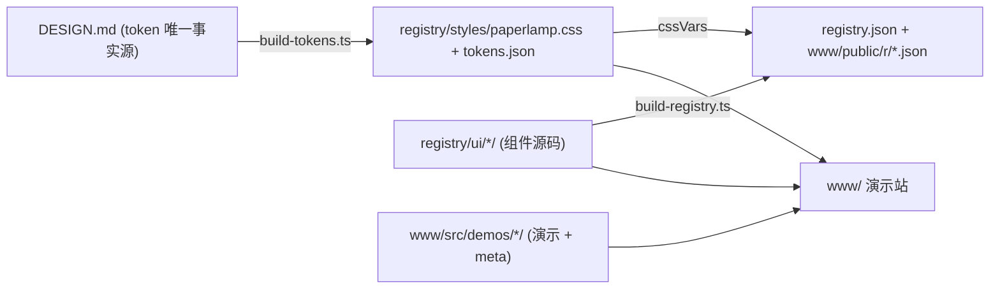

# 纸灯 / Paperlamp

「纸灯 / Paperlamp」是一套 **shadcn 式的 Vue 3 组件库**，服务于「幻觉产物 / AI Toybox」应用。
设计以文本为先、以留白和边框建立秩序，亮暗双主题共享同一层级结构。

和 shadcn 一样，它不是一个 npm 包，而是一个 **registry**：组件源码通过
`npx shadcn-vue add <url>` 拷进你的项目，归你所有、随你修改。所有视觉 token 的唯一事实源是
根目录的 `DESIGN.md`（Google [design.md 格式](https://github.com/google-labs-code/design.md)）。

技术栈：Vue 3 · [Reka UI](https://reka-ui.com)（无头原语）· Tailwind CSS v4 ·
class-variance-authority · lucide-vue-next · vue-sonner。

## 快速开始

```bash
bun install
bun run dev        # 生成 token 与 registry，启动演示站 http://localhost:5180
bun run build      # 类型检查 + 构建静态站到 dist/（含 /r/*.json registry）
```

在其他项目中使用（演示站即 registry 服务器）：

```bash
npx shadcn-vue@latest init
npx shadcn-vue@latest add http://localhost:5180/r/paperlamp.json   # 主题：CSS 变量 + 字体 + 基础样式
npx shadcn-vue@latest add http://localhost:5180/r/button.json http://localhost:5180/r/dialog.json
```

部署到正式域名时用 `REGISTRY_URL=https://your.domain/r bun run build`，
让组件间的 `registryDependencies` 指向正确地址。

## 架构



| 路径 | 说明 |
| --- | --- |
| `DESIGN.md` | 设计系统唯一事实源：YAML frontmatter 存放机器可读 token，正文说明设计意图（含 Known Drift）。 |
| `STYLE.md` | 中文风格手册，与 `DESIGN.md` 同值同步，面向人工查阅。 |
| `registry/ui/<name>/` | 组件源码（等价于 shadcn 的 `registry/new-york-v4/ui`）。只通过 `@/lib/utils`、`@/components/ui/*` 与 npm 包导入，拷进用户项目即可用。 |
| `registry/lib/utils.ts` | `cn()`：clsx + tailwind-merge。 |
| `registry/styles/paperlamp.css` | **生成文件**。shadcn 语义命名的 `:root` / `.dark` 变量、`@theme inline` 映射、排版工具类（`headline-md`、`label-xs`…）与基础层。 |
| `components.json` | shadcn-vue 配置；声明 `@paperlamp` 命名空间 registry。 |
| `registry.json` | **生成文件**。registry 清单（shadcn registry schema）。 |
| `www/` | 演示 / 文档站（Vite + Vue Router）：首页组件画廊、每个组件独立文档页（预览 / 代码 / 安装命令 / 源码）、主题 token 页、亮 / 暗 / 跟随系统切换。 |
| `www/src/demos/<name>/` | 每个组件的 `meta.ts` 与演示 SFC，**自动发现**，无需维护中央列表。 |
| `scripts/` | `build-tokens.ts`（DESIGN.md → 主题 CSS）、`build-registry.ts`（组件 → registry JSON，按 import 自动推断依赖）。 |
| `spec/` | design.md 官方规范副本（Apache 2.0，见 `spec/LICENSE`）。 |
| `.claude/skills/` | 与 DESIGN.md 相关的四个官方 agent skills。 |

新增组件的约定与视觉规则见 [CONTRIBUTING.md](CONTRIBUTING.md)。

## 主题变量映射

变量名与 shadcn 一致，因此任何 shadcn-vue 组件都能直接套用纸灯；冲突处以 shadcn 语义为准，
纸灯自有色族以独立名称暴露：

| shadcn 变量 | DESIGN.md token | 说明 |
| --- | --- | --- |
| `--background` / `--foreground` | `neutral` / `on-surface` | 纸 / 墨 |
| `--card` `--popover` | `surface` | 卡片、浮层表面 |
| `--primary` (+ `--primary-hover`) | `primary` | 墨色主按钮 |
| `--secondary` `--accent` `--muted` | `border` @ 60% / 50% / 40% | 中性弱填充 |
| `--muted-foreground` | `secondary` | 元数据、辅助文字 |
| `--border` `--input` / `--ring` | `border` / `primary` | 细边框；焦点为墨色 |
| `--destructive` | `error` | 只作文字 |
| `--indigo` `--indigo-text` `--indigo-bar` `--indigo-wash` | `accent*` | 唯一交互强调色 |
| `--rating` `--featured*` `--warning*` `--overlay` | 同名 | 星金、精选、警告、遮罩 |

圆角：`rounded-sm` 4px（控件）· `rounded-md` 8px = `--radius`（容器）· `rounded-lg` 12px（仅 Toast）。

## design.md 工具链

```bash
bun run lint             # 校验 DESIGN.md（断引用、WCAG 对比度、章节顺序等）
bun run build:tokens     # DESIGN.md → registry/styles/paperlamp.css
bun run export:css       # 导出 Tailwind v4 @theme CSS 变量
bun run export:dtcg      # 导出 W3C Design Tokens
bun run diff A.md B.md   # 对比两个版本，检测 token 回归
```

修改 `DESIGN.md` 后务必重新 `bun run lint` 与 `bun run build:tokens`；同时更新 `STYLE.md` 保持两份文档一致。
